# Hallow Torrents

A game-aware torrent client for Windows, built on [MonoTorrent](https://github.com/alanmcgovern/monotorrent), that **only ever runs over your VPN**. Part of the Hallow family.

> **The legal bit:** torrenting itself is legal. Downloading or sharing copyrighted material without permission isn't. The VPN lock is for privacy - it doesn't change what the law allows.

## Install

Download `Hallow.Torrents.zip` from the [latest release](https://github.com/Dom428/hallow-torrents/releases/latest), right-click it > Properties > Unblock, Extract All, double-click `INSTALL.bat` (no admin needed) - or install it from Hallow Setup.

## VPN required - always

- Torrents only run while **Hallow VPN** says it's connected, or while **the VPN adapter you picked** (for the NordVPN app: NordLynx or its OpenVPN TAP adapter; WireGuard; any other VPN app) is up with an address. There is no setting to turn this off.
- **Every socket is bound to the VPN's address:** the peer listener, outgoing peer connections, DHT, HTTP(S) and UDP trackers (also the ones you add by hand), web seeds, RSS feeds and blocklist downloads. Tracker and DHT-router names are looked up with Hallow Torrents' own DNS query sent from the VPN address to the VPN's DNS servers - never Windows' resolver. Windows only sends traffic from an address through the adapter that owns it, so nothing can leave through your normal connection; if the VPN adapter disappears, the sockets can't even be opened.
- **If the VPN drops or its address changes, the engine is stopped (not just paused) within a second**, with a clear banner, and started again - bound to the new address - once the VPN is back. The banner's **Connect Hallow VPN** button asks Hallow VPN to connect to the fastest server.
- **One exception, for your own indexer manager only (new in 1.4):** a Prowlarr / Jackett you added in Search that sits at a **private address** - this PC (127.0.0.1), your home network (10.x, 172.16-31.x, 192.168.x) or Tailscale (100.64-127.x) - is reached directly instead of through the VPN, because that traffic never reaches your ISP (Prowlarr / Jackett do the public fetching themselves). The name is looked up first and **every** address it resolves to must be private; the connection goes only to those checked addresses; every redirect is checked again (a redirect to a public address goes back through the VPN, or is refused while it's off). It never applies to trackers, peers, DHT, RSS, blocklists or a .torrent on a public host. Search shows it as *Local server - not through VPN (private address)*.
- **Port forwarding (UPnP / NAT-PMP) is always off** - it would open a port on your home router, outside the VPN. NordVPN doesn't offer port forwarding either, so fewer peers can connect to you; downloads still work, that's normal. IPv6 peers aren't used.
- **Check my torrent IP** (Settings > VPN, only when you click it) opens ipleak.net's torrent address check in your browser, so you can see the address a tracker sees.

## What it does

- **The basics:** add a .torrent file or a magnet link (or drop it on the window); pick the files and the folder; a queue (N downloads at once, move up / down); pause and resume; download and upload limits overall and per torrent; ratio and seeding-time limits (and a ratio goal per category); DHT, peer exchange and local peer discovery, each switchable; encryption preferred or required; a list with progress, speed, ETA, peers and ratio, and a details panel (general, files with Skip / Low / Normal / High, safety & library).
- **More:** sequential download to preview videos while they download, super-seeding, force recheck, categories with their own save folders, a speed schedule by the time of day, a watch folder for .torrent files.
- **RSS auto-download** (new in 1.1): feeds with their own refresh interval; rules with must contain / must not contain (words, `|` for "or", `*`) or regular expressions, a category, a save folder, a quality preference (prefer 1080p) and words to avoid (CAM, TS...). **Episode tracking** (S01E02, 1x02, dates, season packs - and movies by title and year) never grabs the same episode twice; optionally a better quality replaces it within N hours. The rule window previews what it would grab. Feeds are only fetched over the VPN - nothing is checked while it's off.
- **Create torrents** (new in 1.1): from a file or a folder, piece size automatic or your own, trackers (tiers), web seeds, private, comment and source - and start seeding it straight away.
- **Edit torrents** (new in 1.1): add, remove and edit trackers; rename files and folders (the files on disk follow, also while the VPN is off); move storage to another folder; priorities per file or for all files at once.
- **IP blocklist:** from a file, or (new in 1.1) from an address - P2P / PeerGuardian or eMule .dat, plain, .gz or .zip - downloaded over the VPN and updated every N days. Settings shows how many ranges are loaded.
- **Statistics** (new in 1.1): downloaded and uploaded this session and all-time, ratio, time seeding, time torrents waited for the VPN, and peers the blocklist refused - kept on this PC only.
- **Game-aware:** while Delta Force, Discovery, a game Hallow Hub says you're playing or one from your own list runs, it pauses everything (or limits it to N KB/s) and carries on when you stop.
- **Safety:** a finished download is scanned by Microsoft Defender (MpCmdRun custom scan at Idle priority; nothing is deleted by Hallow Torrents). Programs, scripts or shortcuts inside what looks like a video or music download, and disguised names like `movie.mp4.exe`, get a **Check before opening** badge. Downloads are never opened by themselves.
- **Media library hand-off** (per category, off until you set it up): when a download finishes it's copied - or moved and seeded from there - to your library folder (e.g. `\\NAS\media\Movies`) with names Jellyfin understands: `Title (Year)/Title (Year).mkv`, `Show/Season 01/Show - S01E02.mkv`. Flagged downloads are never handed off by themselves.
- **.torrent files and magnet links** can open in Hallow Torrents - for your Windows user only, and only after you say yes.

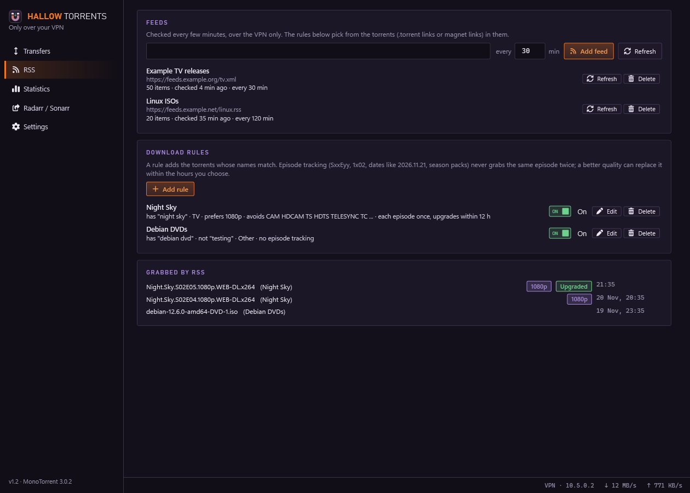

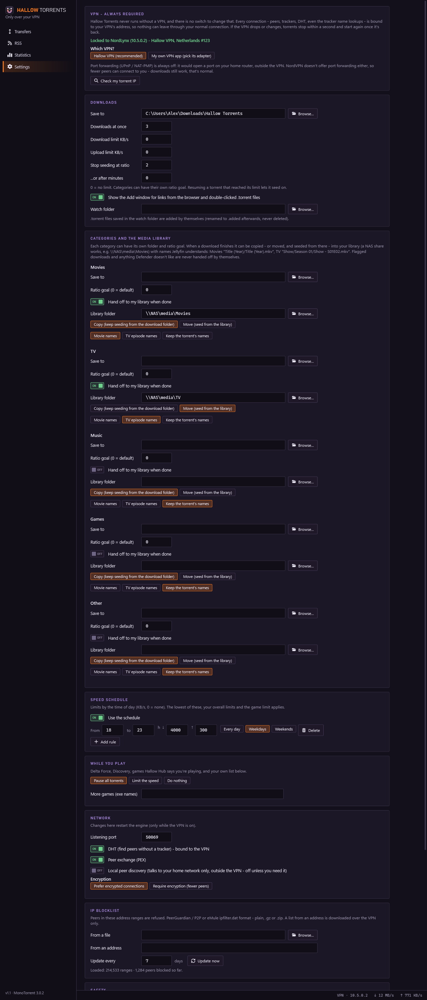

## Speed pass (new in 1.13)

Measured on the local benchmark only (loopback swarms on this PC, Hallow's engine bound to the stand-in VPN address - **no internet**):

- **"Finished" sooner.** The 1.5 recheck of every piece before a download counts as finished stays, but it now starts the moment the engine has the last piece (not at the next 1-second tick), hashes on several threads straight from the files, and a good result marks the download finished at once. Only if it finds a bad piece does MonoTorrent's own recheck run and fetch that piece again (it still happens: in 2 of 3 runs of the 2,000-file test on this PC). With 2,000 small files the time from the last byte to "finished" fell from 7-11 s to about 1.3-3 s; with one 1 GB file from about 5 s to about 3 s.
- **More connection attempts at once** (Balanced 16 -> 48, Max speed 24 -> 96, Light 6 -> 16, gaming 4 -> 8). With 60 dead peers listed before the real ones (what trackers and DHT often hand out) the first byte came after 0.8 s instead of 2.9 s.
- **More peers per torrent** (Balanced 100 -> 200, 500 in all; Max speed 400 / 800). With 150 slow peers (320 KB/s each) a download ran at 42 MB/s instead of 29 MB/s. It also matters with many dead peers: with 150 dead peers listed first, 1.12 never reached the six real ones (stuck at 0%), 1.13 finished every time.
- **A MonoTorrent crash fixed** (found by the benchmark): with many peers connecting at the same moment, MonoTorrent 3.0.2's peer-exchange bookkeeping could throw on a background thread and **close the whole app** (4 of 8 runs with 150 peers and 200 per torrent; possible with 100 per torrent too, only rarer). Hallow now hands those two events over one at a time: 0 crashes in 12 runs of the same test, and none in any later run.
- No change needed: the per-second tick, the socket watchdog (one look at Windows' tables takes about 0.5 ms, every 3 s) and the status file cost nothing measurable. A 64 MB disk cache instead of 32, 1,024 open files instead of 256, 4 / 8 / 16 upload slots and a 5 s instead of 10 s connect timeout made no difference in these tests, so they stay as they were.

Medians of 3 runs (5 for the 150-peer row), 1.12 Balanced -> 1.13 Balanced: average speed / time to the last byte / time to "finished" (after the recheck):

| Set-up | 1.12 | 1.13 |
|---|---|---|
| wan (4 seeders + 2 leechers, 40 ms, 6 MB/s each), 1 GB | 23.0 MB/s, 44.6 s, finished 49.6 s | 22.9 MB/s, 44.8 s, **finished 47.7 s** |
| wan, 2,000 files (251 MB) | 21.3 MB/s, 11.8 s, finished 19.4 s | 21.3 MB/s, 11.8 s, **finished 13.1 s** |
| crowd (80 peers, 320 KB/s each), 1 GB | 23.8 MB/s, 43.0 s, finished 49.6 s | 23.8 MB/s, 43.0 s, **finished 46.1 s** |
| dead (wan behind 60 dead peers), 1 GB | 21.7 MB/s, 47.1 s, first byte 2.9 s, finished 52.7 s | **22.8 MB/s, 45.0 s, first byte 0.8 s, finished 47.4 s** |
| dead, 2,000 files | 17.8 MB/s, 14.1 s, finished 21.2 s | **21.3 MB/s, 11.8 s, finished 13.1 s** |
| lan (no limits), 1 GB | 88.5 MB/s, 11.6 s, finished 16.4 s | 90.6 MB/s, 11.3 s, **finished 14.4 s** |
| lan, 2,000 files | 47.9 MB/s, 5.2 s, finished 16.3 s | 48.1 MB/s, 5.2 s, **finished 8.1 s** |
| 150 peers at 320 KB/s each, 512 MB | 28.7 MB/s, 17.8 s, finished 21.4 s | **42.1 MB/s, 12.2 s, finished 14.4 s** |
| wan behind 150 dead peers, 512 MB | **stuck at 0%** (2 of 2 tries) | 20.6 MB/s, 24.9 s, finished 26.2 s (3 of 3) |

When the peers' own upload is the limit (wan, crowd) nothing on our side can download faster - the gain there is the earlier "finished". **uTP is still not possible:** MonoTorrent 3.0.2 has no uTP at all (TCP only), so peers that only speak uTP, or can only be reached through it, stay out of reach; that and libtorrent's tuning are what qBittorrent still has over us on the internet (see *Honest limits* below). Every socket is still bound to the VPN address; the watchdog, kill switch, leak drill and VPN lock are unchanged. `TorrentsTests.exe bench --scen dead [--dead 60]` runs the new dead-peer set-up.

## Remove all (new in 1.12)

**Remove all** sits next to Pause all and Resume all. It asks first: every torrent, or **only the finished ones**, and whether
their files go to the **Recycle Bin** too (never a permanent delete). By default the files stay where they are. Hallow Remote
can use the pipe's `remove-all --yes [--finished] [--files]`.

## Pause when finished (new in 1.11)

**Settings > Downloads > "Pause torrents when they finish downloading (don't seed)"** (off by default): a torrent is paused as
soon as it has finished - after Hallow Torrents' own full recheck of the files - instead of seeding. Resume it to seed after all
(it isn't paused again). Torrents you made yourself and ones you told to seed past their limit aren't paused.

## Magnets stuck on "Getting info" (new in 1.10)

A magnet link has no file list until a peer sends it, and it finds peers only through its own trackers and DHT. When one sits on
**Getting info** for 75 seconds without finding anyone, Hallow Torrents adds a short list of well-known public trackers to it
(after its own, like qBittorrent's "Automatically add these trackers") and asks the trackers and DHT again - once; while it's
still stuck it asks DHT again every 2 minutes. Every tracker still goes out from the VPN address only. **Settings > "Add public
trackers to magnet links that find no one"** (on) turns it off. The pipe's `details <hash>` explains a stuck torrent: its state,
how long it has been getting info, peers found and connected, each tracker's status and message, DHT's state and node count.

## VPN on demand (new in 1.9)

All of this happens **before** the VPN requirement, never instead of it: torrents still never run without a VPN, every socket is still bound to it, and the watchdog and leak drill are unchanged.

- **Auto-connect** (Settings > VPN, on by default when Hallow VPN is installed): when there's something to download and Hallow VPN is off, Hallow Torrents asks it to connect to a **P2P server** (`connect p2p --once` - the server you picked in Hallow VPN stays picked). It only asks when Hallow VPN's status says the next connect **doesn't need Windows' permission** (IKEv2); if the next connect is NordLynx, the lock banner says *Connect the VPN from Hallow VPN (it needs Windows' permission for NordLynx)* and nothing is sent. If it doesn't connect, it tries again after **30 s, 2 min and 5 min, then stops** until you act (Connect Hallow VPN, `vpn-auto retry`, or the setting). **Never while a game runs**, unless you tick *also while a game is running*; never during the leak drill. The red VPN-lock banner shows what it's doing (asked, next try at..., needs Windows' permission, game running, stopped).
- **P2P servers only** (off by default): torrents run only while Hallow VPN reports a P2P server (`p2p: true`). On any other server they stop exactly as if the VPN had dropped, and the banner offers **Switch to a P2P server** (the same `connect p2p --once`, with the same Windows-permission rule). With your own VPN app's adapter (e.g. the NordVPN app) Hallow Torrents can't tell which server you're on, so the option can't be ticked and counts as off.
- **Kill switch tip:** when Hallow VPN's kill switch is off, Settings > VPN suggests turning it on in Hallow VPN (a second layer for every app); *Hide tip* hides it for good.
- New on the pipe: `vpn-auto [on|off|games on|games off|retry]`, `p2p-only [on|off]`, `switch-p2p`; `status` adds `vpnAuto` and `p2pOnly`. Details in [REMOTE-CONTRACT.md](REMOTE-CONTRACT.md).

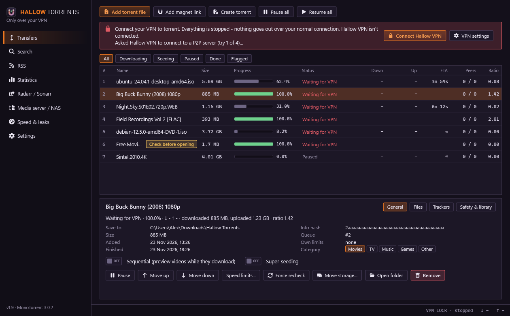

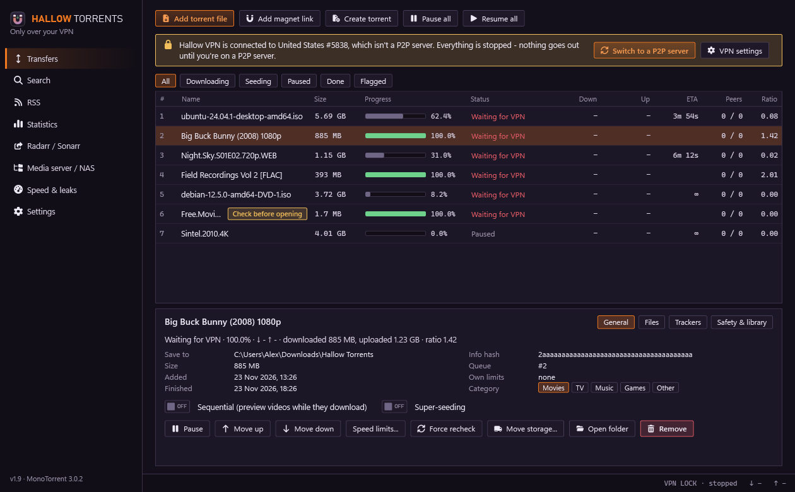

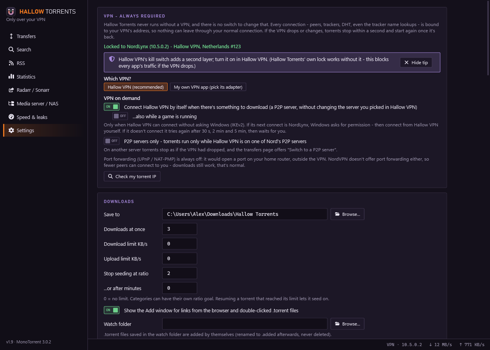

## For Hallow Remote and Hub (new in 1.8)

- **`categories`** on the pipe answers your category names only (`ok {"categories":["Movies","TV",...],"count":N}`) - Hallow Remote's add-magnet picker uses it. Never folders or rules.
- **Searches no longer collide.** `search ... --client <id>` and `search-add <id> --client <id>` keep each caller's result ids apart, so two phones (or a phone and Hub) searching at the same time don't lose each other's results. Without `--client` it works exactly as before (one shared set). The Search page and each web-interface sign-in keep their own results as well. Details in [REMOTE-CONTRACT.md](REMOTE-CONTRACT.md).

## Plex and Emby too (new in 1.7)

The page is now **Media server / NAS** and starts with a choice: **Jellyfin / Emby / Plex / None (just copy)**. If you used 1.6, nothing changes - your settings carry on as Jellyfin.

- **Emby:** the same folder names as Jellyfin. Type its address (e.g. `http://192.168.4.197:8096`) and an **API key** (Emby: Dashboard > Advanced (under Expert) > Security > + Add - newer Emby: Settings > API Keys > New API Key; use an admin's key, Emby only lets admins start a scan). **Check the server** shows its name and version (`/emby/System/Info/Public`); after a copy Emby is told about the new folders (`/emby/Library/Media/Updated` with `X-Emby-Token`, falling back to `/emby/Library/Refresh`), once for a batch.
- **Plex:** Plex's own names - movies `Movies\Title (Year)\Title (Year).mkv`, TV `Shows\Show (Year)\Season 01\Show (Year) - s01e02.mkv` (the year when the name has one). Type the server's address (port **32400** is assumed if you leave it out) and your **X-Plex-Token**:
  1. open Plex Web (`http://192.168.4.197:32400/web` or app.plex.tv) and sign in as the server's owner,
  2. open any movie or episode, click **...** (More) > **Get Info**,
  3. click **View XML** (bottom left) - a new tab opens,
  4. at the very end of its address is `X-Plex-Token=...`: copy everything after the `=`, paste it and click **Save token**.

  (From Plex's support article *Finding an authentication token / X-Plex-Token*.) Then **Load libraries** and pick your Movies and TV libraries. After a copy Plex scans just the new folder (`/library/sections/<id>/refresh?path=<the folder as Plex sees it>`), once for a batch; if the folder can't be matched to the library's folder, the whole library is scanned. **Check the server** uses `/identity` (no token needed).
- **None (just copy):** files are copied with Jellyfin-style names and no server is called.
- **The same rules as 1.6:** the server's address must be on your own network (a public one is refused before connecting), never through the VPN binding; the key / token is kept encrypted for your Windows user (DPAPI, nas.json), sent only in a header (never in a web address) and never shown or logged; the NAS password is never stored. Defender gate, verified resumable copies, per-category rules and the offline queue are unchanged.
- `nas-status` and status.json's `nas` block gain `server` (`jellyfin` / `emby` / `plex` / `none`) plus `serverAddress` / `serverKey` (set or not - never the address or key).

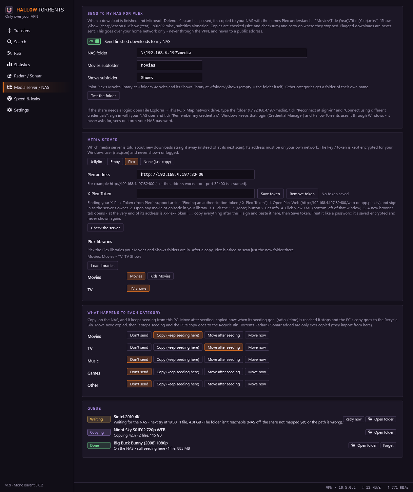
## Send to Jellyfin (new in 1.6)

Finished downloads can go straight to the **Jellyfin library on your NAS** - the **Jellyfin / NAS** page.

- **Where:** a folder on your NAS, e.g. `\\192.168.4.197\media` (or a drive letter you mapped to it), with **Movies** and **Shows** subfolders (change or empty them); other categories get a folder of their own name. **Test the folder** checks it's reachable and writable (it writes and deletes a small temp file).
- **Your own network only, never through the VPN:** the NAS must be at a private address (home network or Tailscale), or a home-network name that resolves only to private addresses - the same rules as 1.4's local indexer exception. A public address is refused. Files are copied by Windows' own SMB client.
- **No NAS password in Hallow Torrents:** if the share needs a login, map it once in File Explorer (This PC > **Map network drive** > the folder > tick **Reconnect at sign-in** and **Connect using different credentials** > your NAS user > tick **Remember my credentials**). Windows keeps that login and Hallow Torrents goes through Windows.
- **When:** only after the download is finished, rechecked and **Microsoft Defender's scan has passed**. Flagged downloads and anything Defender found something in are never sent.
- **Jellyfin names:** `Movies\Title (Year)\Title (Year).mkv`, `Shows\Show\Season 01\Show - S01E02.mkv`, subtitles alongside; samples and .nfo files stay behind.
- **Safe copies:** each file goes to `<name>.hallow-part` first, carries on where it stopped after an interruption (the bytes already there are checked first), then its **size and SHA-256 are compared** with the download before it's renamed. A different file already on the NAS is never overwritten.
- **Per category:** **Copy** (and keep seeding from this PC), **Move after seeding** (copied now; when the seeding goal is reached it stops and the PC's copy goes to the Recycle Bin), **Move now** (copied, then seeding stops and the PC's copy goes to the Recycle Bin), or **Don't send**. Torrents Radarr / Sonarr added are only ever copied. Never a permanent delete.
- **NAS off?** The item waits and is tried again after 30 s, 1, 2, 4... up to 30 minutes; the queue shows progress, *Retry now* and *Open folder*.
- **Jellyfin (optional):** its address (e.g. `http://192.168.4.197:8096`, private only) shows the server's name and version (`/System/Info/Public`, no key). With an **API key** (Jellyfin: Dashboard > API Keys > +) it's told about new folders straight away (`/Library/Media/Updated`, falling back to a library scan), once for a batch. The key is kept encrypted for your Windows user (DPAPI, nas.json) and never shown or logged.
- status.json gets a `nas` block and the pipe answers `nas-status` - counts only, never file names, the folder or the key.

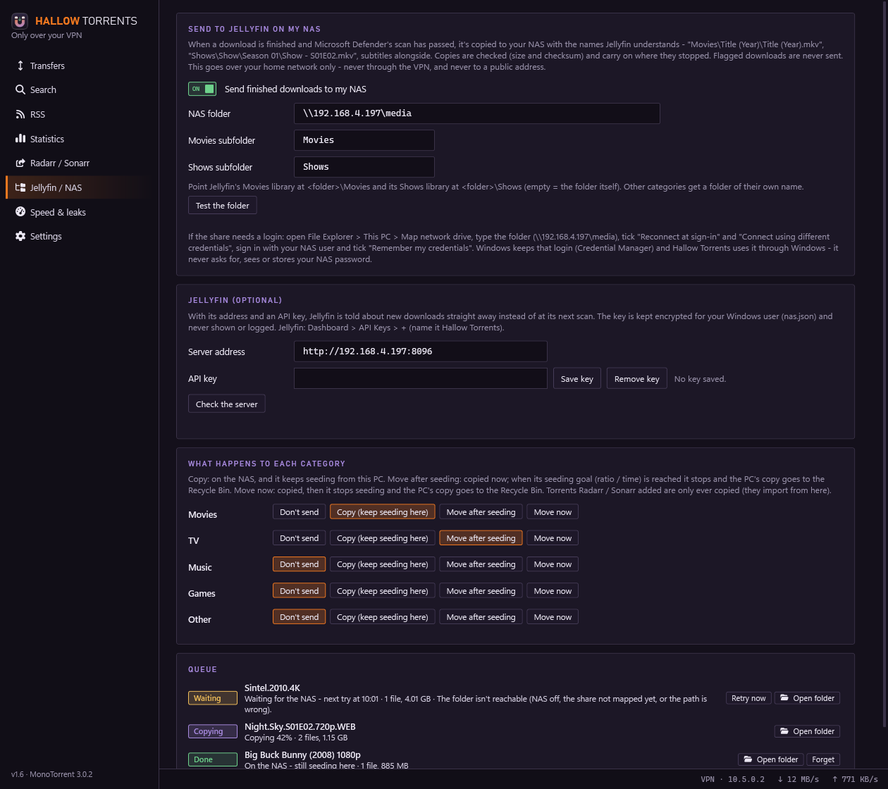
## Speed and proof (new in 1.5)

**The goal:** never leak, and be as good as NordVPN + qBittorrent. The VPN lock was already strict; 1.5 adds proof that it holds, a watchdog behind it, and faster defaults measured on a benchmark.

- **Performance profiles** (Settings > **Performance**): **Balanced** (default), **Max speed**, **Light**, plus *Advanced numbers* (peers at once, per torrent, connecting at once, disk cache, upload slots, open files; 0 = the profile's). Balanced allows 300 peers (100 per torrent, 1.4 had 150 / 60; **1.13: 500 / 200**), 16 connection attempts at once (8; **1.13: 48**), a 32 MB disk cache (5 MB), 256 open files and 3 duplicate requests per block in end-game mode (2). While a game runs and *While you play* is set to **Limit the speed**, a small gaming profile (50 peers, 4 MB cache, 3 upload slots) is used by itself; with **Pause all** nothing runs anyway. Changes apply straight away, also to running torrents. **Only numbers change - every socket still comes from the same VPN-bound code**, and the profile can't turn anything off.
- **Every finished download is rechecked before it counts as finished** (fix): the benchmark caught MonoTorrent 3.0.2 reporting a torrent with many small files complete while a 16-32 KB block on disk had never been written (zeros) - in roughly 1 in 3 runs of the 2,000-file test, **with 1.4's settings too**. 1.5 rechecks every piece on disk when the engine says "done" and downloads any bad piece again (status.json `repairedPieces` counts them). It costs one read of the download (about 7 s for 2 GB). Also fixed: stopping the engine (VPN drop, quit) no longer cuts off data that was still being written from the cache - network first, then up to 30 s for the disk.
- **Prefer encryption** now encrypts the handshake first and uses full-stream RC4 only when the other side asks (MonoTorrent's and qBittorrent's default) - the same peers connect, with **about a quarter less CPU** than 1.4's full-RC4-first order in the benchmark. *Require encryption* is unchanged. Everything is inside the VPN tunnel either way.
- **Socket watchdog** (always on, no switch): every 3 seconds it reads Hallow Torrents' **own rows in Windows' TCP and UDP tables** (IPv4 and IPv6). Allowed: the VPN address (and one it was bound to in the last 2 minutes - a socket on a vanished adapter can't send), loopback, the Radarr / Sonarr Web API on the one address you picked while it runs, your own Prowlarr / Jackett at a private address (1.4's exception) and the GitHub update check - those two now register their own sockets with the watchdog before connecting. **Anything else** - your normal connection, 0.0.0.0, IPv6 - **stops every torrent at once** and shows a red alert; torrents stay stopped until you click *I've checked - resume*. Defence in depth: with the binding working it never fires.
- **Speed test** (the **Speed & leaks** page, or the pipe `speedtest`): downloads a legal, well-seeded torrent you pick - one click uses **Ubuntu's current desktop image** (its .torrent is fetched from releases.ubuntu.com **over the VPN, only when you click**) - like any other torrent, and shows average and peak speed, time, peers and CPU. Files go to `<save folder>\Speed test`; it's paused when done (no seeding on by itself).
- **Leak drill** (same page, or `leak-drill`): while a torrent downloads over your real VPN it **disconnects the VPN on purpose** (Hallow VPN through its pipe; your own VPN app - you disconnect it when asked) and checks: torrents locked **within 2 s**; **no socket of this app on a non-VPN address** (Windows' tables sampled every 100 ms through the whole drill); the engine's sockets closed; **no data moved** while locked; then it reconnects (the same server) and checks the download **resumes**, bound to the VPN again. A PASS / FAIL report on the page and in `leak-drill.json` / `.txt` in the data folder.
- **Race against qBittorrent** (`tools\race.ps1` in the install folder): Hallow Torrents' speed test, then the **same torrent in your qBittorrent with its network interface bound to the VPN adapter** for the race (set through qBittorrent's Web UI, put back afterwards), and a comparison table. You start it, with your VPN connected. `tools\speedtest.ps1` is the speed test alone.
- **uTP:** MonoTorrent 3.0.2 has **no uTP** (TCP peers only), so there's nothing to switch on. It could only ever be allowed with its UDP socket bound to the VPN like everything else.

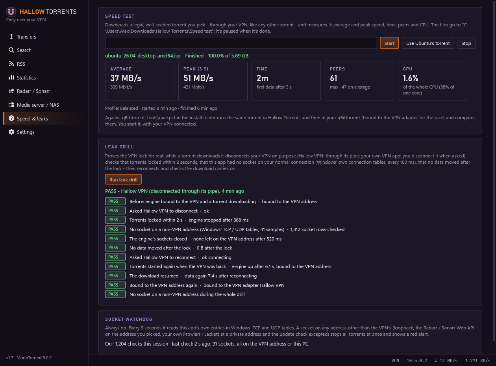

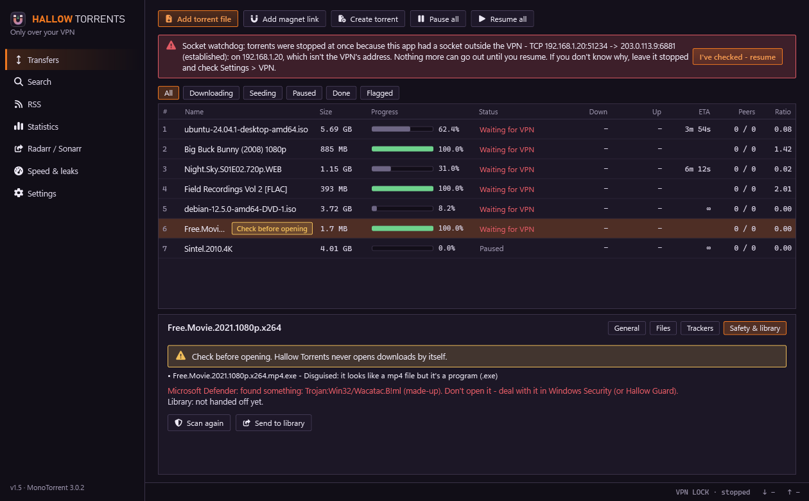

### The benchmark (local, on this PC - not the internet)

`TorrentsTests.exe bench` builds a swarm on loopback addresses: a tracker, seeders and two other leechers (plain MonoTorrent engines, new for every run), and Hallow Torrents' own engine in a separate process bound to a stand-in VPN address, so its CPU, memory and disk writes are its own. Generated data in %TEMP% (2 GB in one file, and 2,000 files of 4-256 KB = 251 MB), deleted afterwards; BelowNormal priority; a run is thrown away and repeated if Delta Force or Discovery starts. Three set-ups: **lan** (4 seeders + 2 leechers, no limits - CPU / disk bound), **wan** (the same with 40 ms round-trip latency through a delay relay and 6 MB/s upload per peer), **crowd** (80 seeders, 40 ms, 320 KB/s each - like a popular torrent with many slow peers). "1.4 settings" = exactly what 1.4 ran (MonoTorrent's defaults, full-RC4-first, no recheck). Medians of 2 runs, final 1.5 build, Ryzen 9 7900X, NVMe:

| Set-up, torrent | 1.4 settings | 1.5 Balanced | 1.5 Max speed |
|---|---|---|---|
| crowd, 2 GB | 18.2 MB/s - downloaded in 112.7 s | **24.3 MB/s - 84.3 s** (+34%); finished incl. recheck 94.5 s | 24.4 MB/s - 84.1 s |
| wan, 2 GB | 23.2 MB/s - 88.3 s, CPU 98.6 s | 23.2 MB/s - 88.5 s, **CPU 75.2 s** (-24%) | 23.2 MB/s - 88.2 s, CPU 75.1 s |
| wan, 2,000 files | 20.6 MB/s - 12.2 s | 21.5 MB/s - 11.7 s | 20.8 MB/s - 12.1 s |
| lan, 2 GB | 95-132 MB/s over three rounds | 95-105 MB/s over three rounds | 90-114 MB/s |
| lan, 2,000 files | 43.6 MB/s - 5.8 s, **1 run of 2 finished with 2 bad pieces on disk** | 43.1 MB/s - 5.8 s, every run verified | 43.9 MB/s - 5.7 s, every run verified |

Also measured: peak memory 56-76 MB in every case (Balanced about 5 MB more than 1.4); bytes written = the download size, nothing extra; a full recheck of 2 GB from disk takes about 7 s (MonoTorrent hashes on one thread, ~290 MB/s).

What it shows, honestly:
- With **many peers** (crowd) Balanced is **a third faster**, because 1.4 stopped at 60 peers per torrent.
- When the peers' own upload is the limit (wan), nothing on our side can make it faster - but 1.5 uses **about a quarter less CPU** for the same download (the encryption change).
- On an unlimited loopback link (lan) the round-to-round noise is bigger than any difference, so no speed claim there.
- **Integrity:** with 1.4's settings, about 1 in 3 runs of the 2,000-file torrent (6 of 16 in a separate check) "finished" with a 16-32 KB block of zeros on disk. 1.5's recheck found and re-downloaded those pieces every time (0 bad of 16 in the same check); it adds about 4-5 s per GB before a download counts as finished.
- Max speed didn't beat Balanced here (it only matters with well over 100 peers), so **Balanced is the default**. These are loopback numbers - your real speed depends on the VPN server and the swarm; the **speed test** and **race** measure that.
### Honest limits (MonoTorrent vs libtorrent)

qBittorrent runs on libtorrent (C++); Hallow Torrents on MonoTorrent 3.0.2 (C#). What that means:

- **No uTP** in MonoTorrent - only TCP peers. Some peers (mostly behind strict NATs, or that only speak uTP) won't connect.
- **More CPU:** about 23-37 CPU-seconds per GB in the 1.5 benchmark (libtorrent typically needs a fraction of that). On a 12-core PC it's a few percent of the CPU; the gaming profile and game pause keep it out of your way.
- **Piece verification is single-threaded** in MonoTorrent (~290 MB/s here: 7.2 s for 2 GB); libtorrent hashes on several threads. (1.13: Hallow's own recheck before "finished" hashes on several threads; MonoTorrent's is only used when a piece is bad.)
- **Silent peers stay connected:** a peer that accepts the connection but never answers the handshake keeps its slot in MonoTorrent 3.0.2 (75 such peers were held for minutes in the 1.13 benchmark); libtorrent drops them after a timeout. 1.13's larger per-torrent limit leaves room around them, it doesn't drop them.
- **Connection pacing:** MonoTorrent tries new peers on its own half-second tick, limited by "connecting at once"; libtorrent paces about 30 new attempts per second.
- **Not adjustable in 3.0.2:** the request queue depth per peer (MonoTorrent sizes it by itself), tracker and DHT announce intervals (the tracker's interval is used), file preallocation / sparse files. Choke / unchoke is tuned only through upload slots.
- **No port forwarding** through NordVPN (it doesn't offer it), so incoming connections are rare - true for qBittorrent over NordVPN too.
## Search (new in 1.3)

Search your **own** indexers from Hallow Torrents: **Prowlarr** or **Jackett** (on this PC or, later, your NAS) - or single **Torznab** feeds. There's no built-in site list and nothing is scraped from torrent websites.

- **Add them:** Search > **Indexers...** > Prowlarr, Jackett or Torznab feed > the address (http://localhost:9696 for Prowlarr, http://localhost:9117 for Jackett) and the **API key** (Prowlarr: Settings > General; Jackett: the top of its page). The indexers inside Prowlarr / Jackett are found for you, each can be switched off. The key is kept **encrypted for your Windows user** (DPAPI) in search.json - never in settings.json, never shown or logged.
- **Over the VPN only, like everything else:** every search, the indexer list and every .torrent download go out from the VPN-bound socket with names looked up over the VPN. **While the VPN is off nothing is sent** - the page says so. **New in 1.4:** a Prowlarr / Jackett at a private address (this PC, your NAS, Tailscale) is reached directly, also while the VPN is off - see *VPN required* above for the exact rules; its status pill says *Local server - not through VPN (private address)*. Its .torrent files come straight from it too, but the torrents themselves only ever run over the VPN, and anything it redirects to on a public host goes through the VPN or not at all.
- **All indexers at once**, each with its own timeout (15 s), and a status pill for each: results and time, *timed out* or *error* (hover for why). Uses Torznab properly: `t=caps` to see what each one supports, `t=tvsearch` with season / episode (type `night sky s01e02`), movie with the IMDb id (type `tt0111161`), categories.
- **Smart ranking.** Release names are read - resolution (480p-2160p), source (Remux, Blu-ray, WEB-DL, WEBRip, HDTV; CAM / TS / TC / screeners count as low quality), codec (x264 / x265 / AV1), HDR / Dolby Vision, audio, group, season / episode - and scored on **health** (seeders, peers), **your profile** (Search > **Ranking...**: e.g. *1080p WEB-DL preferred, avoid CAM, max 8 GB*), **a size that makes sense** for the quality and runtime, and **how reliable the indexer has been**. Click a result to see exactly how its score was made.
- **Likely fakes go to the bottom, with the reason:** a program (.exe, .scr, .lnk...) in a video's file list (when the indexer gives the files, or after **Check files** fetches its .torrent - optional for the top results automatically), a hint at a password-protected archive, a size far too small for the claimed quality, a brand-new upload with too-good-to-be-true seeders, "codec pack" style names.
- **Filters and sorting:** quality, size, seeders, indexer, category; sort by the smart score or any column. Results you already have are marked *In your list* (or *RSS has it*).
- **Download** opens the normal Add window (files, category, folder) - VPN-locked, scanned by Microsoft Defender when it finishes, like any other torrent. **Add to RSS rule** makes a rule for that show or movie that prefers the same quality.

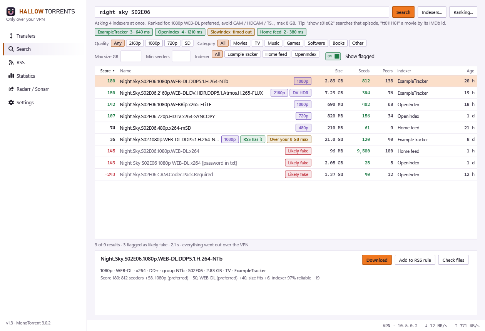

## Web interface and your phone (new in 1.4)

A Hallow Torrents page for your phone or another PC - **off by default**. It's served by the same local server as the Radarr / Sonarr Web API, with the same address, port, sign-in and security:

- **Turn it on:** the **Radarr / Sonarr** page > set a username and password > turn on the Web API > **Serve the web interface at /ui/**. Then open `http://localhost:8080/ui/` on this PC. For your phone, pick this PC's home-network or Tailscale address under *Where it listens* and open `http://<that address>:8080/ui/` on the phone (on your Wi-Fi or Tailscale). **Never forward the port on your router** - it's never on the internet: internet addresses are refused, and it never listens on 0.0.0.0, a public address or the VPN's.
- **What's on it:** the list (progress, speeds, state, *waits for the VPN*), add a **magnet link** or upload a **.torrent file**, pause / resume (one or all), categories, **search** through your own indexers (the 1.3 search, ranked, fakes flagged), statistics, and the **VPN lock** with a **Connect VPN** button that asks Hallow VPN to connect. Light / dark follows your phone (or pick one).
- **Security:** the Web API's sign-in (salted password hash, sessions that expire, 5 wrong passwords = 15 minutes locked out), a CSRF token on every change plus the other-site check, a strict Content-Security-Policy (only this server's own script and stylesheet - no external scripts, fonts or images, no inline script), no framing, nothing cached.
- Torrents added from the page go straight into the list and **wait for the VPN** like any other.

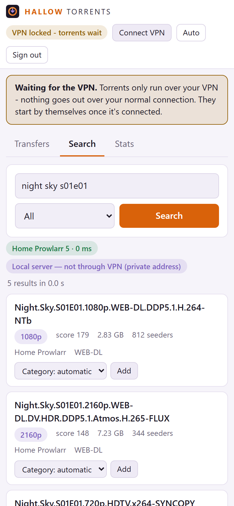

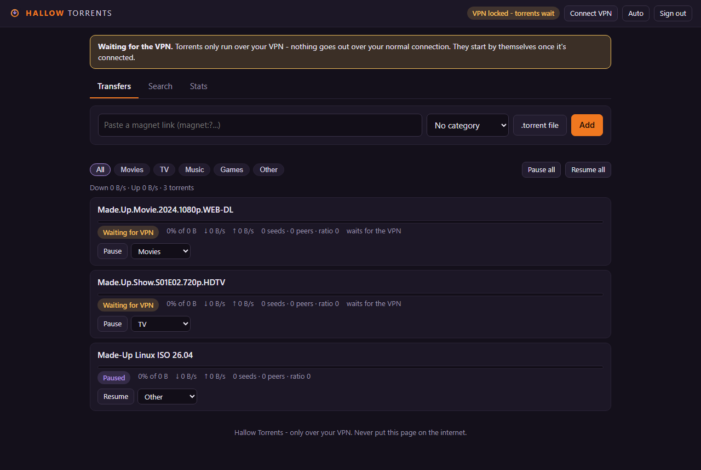

**Hallow Remote:** the family pipe now answers everything a phone page needs (`list`, `pause <hash>`, `resume <hash>`, `stats`, `add <magnet> --direct`, `search`...). The exact commands and JSON are in [REMOTE-CONTRACT.md](REMOTE-CONTRACT.md), so a later Hallow Remote update can add a Torrents tab.

## NAS / headless mode (new in 1.4)

`HallowTorrentsHeadless.exe` (or `HallowTorrents.exe --headless`) runs the engine, RSS, search, the Web API and the web interface with **no window** - for an always-on Windows box. Same data folder, same VPN lock, one copy at a time (it won't start next to the app). It's a separate exe without any WPF / WinForms reference.

Hallow Torrents doesn't run on a Linux NAS: a Mono / .NET 8 build is untested and would need real work to keep the VPN lock absolute on Linux. For a Linux NAS, run **gluetun + qBittorrent** in Docker and point Radarr / Sonarr at it. [NAS-MODE.md](NAS-MODE.md) explains both options honestly and recommends one.

## Use with Radarr/Sonarr/Prowlarr

New in 1.2: Hallow Torrents can stand in for **qBittorrent**. Radarr, Sonarr and Prowlarr only talk to download clients they know, so Hallow Torrents speaks qBittorrent's Web API v2 - the parts they use (sign-in, version, preferences, categories, add by magnet / .torrent / URL, the torrent list, properties, files, share limits, pause / resume and qBittorrent 5's stop / start, priorities, delete).

**Turn it on:** open the **Radarr / Sonarr** page, set a username and a password (8+ characters), switch on the Web API. It listens on `127.0.0.1:8080` (this PC only) unless you pick something else.

**Add it to Radarr** (Sonarr and Prowlarr are the same): Settings > Download Clients > **+** > **qBittorrent**

| Field | Value |
|---|---|
| Host | `localhost` (Radarr on this PC) - or this PC's home-network / Tailscale address (Radarr on another device, see below) |
| Port | `8080` (or the port you set) |
| Use SSL | off |
| Username / Password | the ones you set on the Radarr / Sonarr page |
| Category | `radarr` (Sonarr: `tv-sonarr`; Prowlarr: whatever you like) |

Click **Test**, then **Save**. The category is created in Hallow Torrents the first time an app uses it (or click **Add radarr and tv-sonarr**); give it its own save folder in Settings > Categories if you like.

**Two layouts:**

1. **Everything on this PC** (Radarr / Sonarr / Prowlarr and Hallow Torrents): Host `localhost`, nothing else to do - the paths Hallow Torrents reports are paths Radarr can open. No remote path mapping.
2. **Radarr on your NAS, Hallow Torrents on this PC:**
   - On the Radarr / Sonarr page, pick this PC's **home-network or Tailscale address** under *Where it listens*, and put the NAS's address in **Allowed addresses** (e.g. `192.168.1.20`).
   - In Settings > Categories, point the `radarr` category's folder at a **share on the NAS**, e.g. `\\NAS\downloads\radarr`, so the downloads land where Radarr can reach them.
   - In Radarr: Settings > Download Clients > **Remote Path Mappings** > **+**: Host = this PC's address (the same as in the download client), Remote Path = `\\NAS\downloads\radarr\`, Local Path = that folder as Radarr sees it (e.g. `/downloads/radarr/` in its Docker container). Do the same in Sonarr with `tv-sonarr`.

**What the apps see:**

- Torrents they add **wait for the VPN like any other** - the VPN lock is exactly the same. While the VPN is off (or a game has paused everything) they're reported as `queuedDL`, so the apps show them as queued, never failed.
- **Finished downloads stay where they are** until the app has imported them (`content_path` is the torrent's folder, or the file for a single-file torrent). An app's torrent is never moved into your library first. A download shows as finished only after Microsoft Defender's scan; one that's flagged or that Defender found something in is reported as `error`, so it isn't imported.
- **Seed until ratio / time:** the apps' seed goals (setShareLimits) and your category / global limits are respected. When the goal is reached seeding stops and it's reported `pausedUP`, so an app set to remove completed downloads can remove it. "Remove" with files sends them to the Recycle Bin - Hallow Torrents never deletes permanently.
- A `.torrent` URL is downloaded over the VPN only (later, if the VPN is off right now).

**Security:**

- **Off by default.** A sign-in is required for everything; the password is kept only as a salted hash.
- The sign-in (an `SID` cookie) **expires** after 60 minutes unused (you can change it); the apps sign in again by themselves.
- **5 wrong passwords in 15 minutes lock that address out for 15 minutes.**
- It listens on **one** address: `127.0.0.1` by default, a home-network or Tailscale address only if you pick it - never `0.0.0.0`, never a public address, never the VPN's. Requests from internet addresses are always refused, and the optional **allow-list** narrows it to the devices you name.
- Requests whose `Origin` / `Referer` is another site are refused (like qBittorrent's CSRF protection).
- **Never forward this port on your router or expose it to the internet.** It's for your own devices.

## Hallow family

- Pipe `HallowFamily.Torrents.<user>`, also `HallowTorrents.exe --cmd "<line>"`:
  - `ping`, `status` (counts and speeds, VPN lock state, game - never torrent names, hashes or addresses)
  - `add <magnet link or .torrent path> [--category <name>]` - for Hallow Browser and scripts: shows the Add window (or adds straight away if that's switched off); only `magnet:` links and existing `.torrent` files are accepted; `--category` picks one of your categories (and its folder)
  - `search <words> [--n 10] [--cat movies|tv|music|games|software|books|other]` (1.3) - searches your indexers over the VPN and answers the top N as JSON (title, indexer, size, seeders, peers, score, resolution / source / codec / HDR / audio / group, season / episode, category, flags, an `id`); `error waiting for the VPN...` while it's off (nothing is sent). `search-add <id> [--category <name>]` adds a result through the normal add. Never returns API keys.
  - `list`, `stats`, `pause <hash>`, `resume <hash>` (1.4) - for Hallow Remote and scripts: the list as JSON (name, progress, speeds, state, VPN-locked flag...), statistics, pause / resume one torrent; `add ... --direct` adds without the Add window. All shapes: [REMOTE-CONTRACT.md](REMOTE-CONTRACT.md)
  - `speedtest [ubuntu|<magnet>|<path.torrent>|status|stop]`, `leak-drill [status|--wait]`, `watchdog [resume]` (1.5) - see [REMOTE-CONTRACT.md](REMOTE-CONTRACT.md); never an address
  - `nas-status` (1.6) - the Send-to-NAS queue as counts; 1.7 adds `server` (`jellyfin` / `emby` / `plex` / `none`)
  - `categories` (1.8) - your category names only; `search` / `search-add` take `--client <id>` (1.8) so each caller keeps its own result ids
  - `vpn-auto [on|off|games on|games off|retry]`, `p2p-only [on|off]`, `switch-p2p` (1.9) - VPN on demand; `invoke switch-p2p` and the menu item *Switch to a P2P server* too
  - `open [transfers|search|rss|stats|apps|nas|proof|settings]` (`jellyfin`, `emby`, `plex` open the Media server / NAS page too)
  - `pause-all`, `resume-all`, `menu`, `invoke <id>`, `quit`
- `%APPDATA%\HallowTorrents\status.json` (1.2 adds `webApi`: on or off - never its address or sign-ins; 1.3 adds `indexers`: how many are switched on - never their names, addresses or keys; 1.4 adds `webUi` and `headless`; 1.5 adds `perf`, `watchdog`, `watchdogLocked`, `speedTest`, `leakDrill`, `repairedPieces`; 1.6 adds `nas`; 1.7 adds `server` inside it; 1.9 adds `vpnAuto` and `p2pOnly`), Hallow Hub's one Hallow icon, the Hallow accent and light / dark mode, crash reports kept on this PC, updates from GitHub with a checksum check.

## Good to know

- Your list, settings, RSS feeds and rules (rss.json), indexers and the ranking profile (search.json, keys encrypted) and statistics (stats.json) are in `%APPDATA%\HallowTorrents`; downloads go to `Downloads\Hallow Torrents` unless you choose otherwise.
- Local peer discovery talks to your home network (not the internet) and can't be bound to the VPN, so it's off unless you switch it on.
- Built with the C# compiler in Windows (`build.ps1`). Third-party components and their licences: [licenses/THIRD-PARTY.md](licenses/THIRD-PARTY.md) - MonoTorrent 3.0.2 and its dependencies, all MIT.
- Tests (`build.ps1 -Tests`, `tests\TorrentsTests.exe`) only use a local swarm on this PC: a local tracker, a local seeder, a local web server for RSS and blocklists, and Hallow Torrents bound to a stand-in VPN address (127.0.0.3). The 1.3 search tests (`TorrentsTests.exe search`) use a local Torznab stand-in (playing Prowlarr and Jackett, with fixture results: good releases, CAMs, fakes with an .exe, wrong sizes, a slow and a broken indexer) and check every request comes from the stand-in VPN address - real indexers are never called. The 1.4 tests (`TorrentsTests.exe local`, `web`, `headless`) check the private-address rules (including mixed answers, DNS rebinding to a public address and a redirect to a public host) against a stand-in local and a stand-in public server, the web interface (sign-in, CSRF, CSP, add a magnet / a .torrent, pause / resume, the search proxy) with the local swarm, the headless exe (no window, no WPF loaded, the pipe and the web interface), and the pipe's JSON shapes. The 1.2 contract tests (`TorrentsTests.exe arr`) replay the requests Radarr, Sonarr and Prowlarr send to qBittorrent against the Web API on 127.0.0.1 - no real *arr app is installed.

The 1.5 tests (`TorrentsTests.exe unit15`, `proof`, `race`, `benchsmoke`, `app15`) check the profiles (the 1.4 baseline is exactly MonoTorrent's defaults; a live switch keeps the listener on the VPN address), the watchdog on Windows' real table during a download (no false alarm) and with an injected non-VPN row (locked in under a second, stays locked until resumed), real sockets on 0.0.0.0 / IPv6 / this PC's LAN address being caught, the leak drill against the stand-in VPN (PASS, and FAIL when a non-VPN socket appears during the drop), the speed test on the local swarm and Ubuntu's .torrent from a stand-in (never ubuntu.com), the benchmark at small sizes, `race.ps1` against a local qBittorrent Web API stand-in (bound before the torrent is added, put back afterwards) and the pipe of a test copy.

The 1.6 tests (`TorrentsTests.exe unit16`, `nas`, `app16`) use a temp folder as the NAS and a local Jellyfin stand-in: the private-address rules (a public address, a name resolving to one, a mapped drive to one - refused), Jellyfin names, copy and verify, resume after an interrupted copy (and a bad partial file thrown away), never overwriting a different file, offline waiting with back-off, the three category rules, flagged / Defender / still-scanning downloads never sent, the debounced refresh with the key in the header only, the key never in nas.json in plain text or in the log / status / pipe.

The 1.7 tests (`TorrentsTests.exe unit17`, `servers`, `app17`) use local Emby and Plex stand-ins on 127.0.0.1: server info (Emby's `/emby/System/Info/Public`, also when it wants the key; Plex's `/identity` without the token), Plex's library list, the debounced refresh calls (Emby `/Library/Media/Updated`; Plex one partial scan per new folder in the right library at Plex's own path), refused keys / tokens, a removed library, the token only in a header and never in nas.json in plain text, the log, a URL, status or the pipe, Plex's naming, public addresses refused, None (just copy), and 1.6 settings coming up as Jellyfin in a test copy. The only contact with the real NAS was a read-only `GET /identity` (Plex - not answering yet) and `GET /System/Info/Public` (Jellyfin).

The 1.8 tests (`TorrentsTests.exe unit18`, `app18`) check `categories` (names only, never folders) and per-client search ids against the windowed test copy and the headless exe with a local Torznab stand-in: two clients' searches keep their own ids, one client can't add another's result, the shared set without `--client` still works as in 1.3, bad `--client` names are refused, and the oldest of more than 32 clients is dropped.

The 1.9 tests (`TorrentsTests.exe unit19`, `vpn19`, `app19`) use a fake Hallow VPN - its status.json in the test folder and a stand-in pipe whose name ends in `.test-<folder>`, so the real Hallow VPN is never sent anything: the back-off on a made-up clock (now, 30 s, 2 min, 5 min, then stop until you act), the game hold and *also during games*, needsUac (nothing sent), not running, connecting, the leak drill, errors and no answer, P2P servers only (it can only turn an OK into a stop, never the other way), your own VPN app's adapter (P2P-only counts as off, Hallow VPN never asked), the pipe commands and status fields in the windowed test copy and the headless exe. All earlier suites, including the lock and leak tests, run unchanged.

Pictures use made-up torrents.
