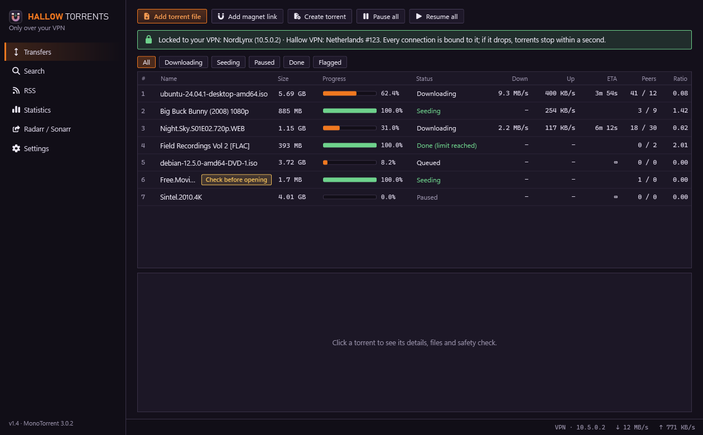
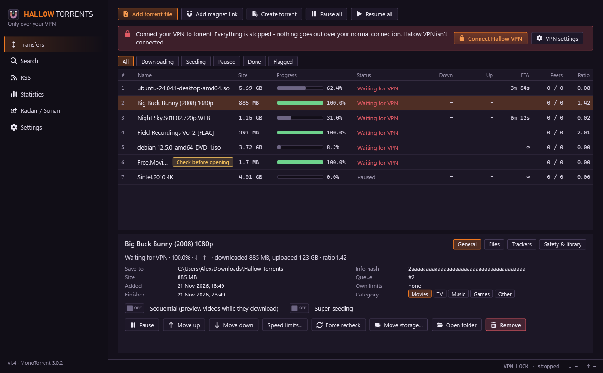
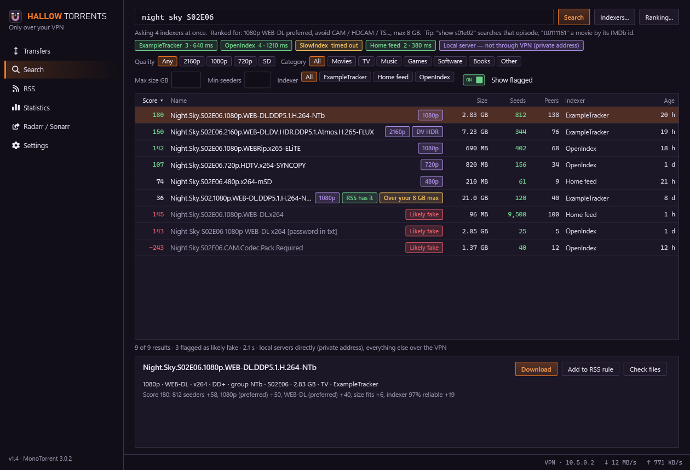
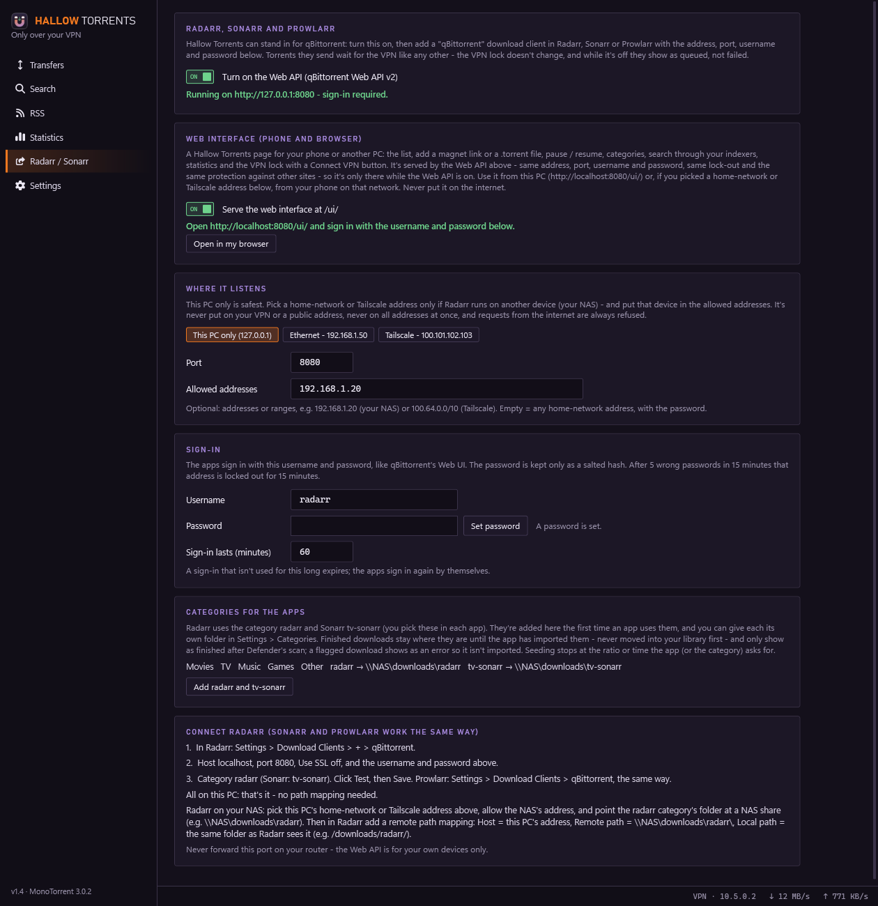

# Hallow Torrents

A game-aware torrent client for Windows, built on [MonoTorrent](https://github.com/alanmcgovern/monotorrent), that **only ever runs over your VPN**. Part of the Hallow family.

> **The legal bit:** torrenting itself is legal. Downloading or sharing copyrighted material without permission isn't. The VPN lock is for privacy - it doesn't change what the law allows.

## Install

Download `Hallow.Torrents.zip` from the [latest release](https://github.com/Dom428/hallow-torrents/releases/latest), right-click it > Properties > Unblock, Extract All, double-click `INSTALL.bat` (no admin needed) - or install it from Hallow Setup.

## VPN required - always

- Torrents only run while **Hallow VPN** says it's connected, or while **the VPN adapter you picked** (for the NordVPN app: NordLynx or its OpenVPN TAP adapter; WireGuard; any other VPN app) is up with an address. There is no setting to turn this off.
- **Every socket is bound to the VPN's address:** the peer listener, outgoing peer connections, DHT, HTTP(S) and UDP trackers (also the ones you add by hand), web seeds, RSS feeds and blocklist downloads. Tracker and DHT-router names are looked up with Hallow Torrents' own DNS query sent from the VPN address to the VPN's DNS servers - never Windows' resolver. Windows only sends traffic from an address through the adapter that owns it, so nothing can leave through your normal connection; if the VPN adapter disappears, the sockets can't even be opened.
- **If the VPN drops or its address changes, the engine is stopped (not just paused) within a second**, with a clear banner, and started again - bound to the new address - once the VPN is back. The banner's **Connect Hallow VPN** button asks Hallow VPN to connect to the fastest server.
- **One exception, for your own indexer manager only (new in 1.4):** a Prowlarr / Jackett you added in Search that sits at a **private address** - this PC (127.0.0.1), your home network (10.x, 172.16-31.x, 192.168.x) or Tailscale (100.64-127.x) - is reached directly instead of through the VPN, because that traffic never reaches your ISP (Prowlarr / Jackett do the public fetching themselves). The name is looked up first and **every** address it resolves to must be private; the connection goes only to those checked addresses; every redirect is checked again (a redirect to a public address goes back through the VPN, or is refused while it's off). It never applies to trackers, peers, DHT, RSS, blocklists or a .torrent on a public host. Search shows it as *Local server - not through VPN (private address)*.
- **Port forwarding (UPnP / NAT-PMP) is always off** - it would open a port on your home router, outside the VPN. NordVPN doesn't offer port forwarding either, so fewer peers can connect to you; downloads still work, that's normal. IPv6 peers aren't used.
- **Check my torrent IP** (Settings > VPN, only when you click it) opens ipleak.net's torrent address check in your browser, so you can see the address a tracker sees.

## What it does

- **The basics:** add a .torrent file or a magnet link (or drop it on the window); pick the files and the folder; a queue (N downloads at once, move up / down); pause and resume; download and upload limits overall and per torrent; ratio and seeding-time limits (and a ratio goal per category); DHT, peer exchange and local peer discovery, each switchable; encryption preferred or required; a list with progress, speed, ETA, peers and ratio, and a details panel (general, files with Skip / Low / Normal / High, safety & library).
- **More:** sequential download to preview videos while they download, super-seeding, force recheck, categories with their own save folders, a speed schedule by the time of day, a watch folder for .torrent files.
- **RSS auto-download** (new in 1.1): feeds with their own refresh interval; rules with must contain / must not contain (words, `|` for "or", `*`) or regular expressions, a category, a save folder, a quality preference (prefer 1080p) and words to avoid (CAM, TS...). **Episode tracking** (S01E02, 1x02, dates, season packs - and movies by title and year) never grabs the same episode twice; optionally a better quality replaces it within N hours. The rule window previews what it would grab. Feeds are only fetched over the VPN - nothing is checked while it's off.
- **Create torrents** (new in 1.1): from a file or a folder, piece size automatic or your own, trackers (tiers), web seeds, private, comment and source - and start seeding it straight away.
- **Edit torrents** (new in 1.1): add, remove and edit trackers; rename files and folders (the files on disk follow, also while the VPN is off); move storage to another folder; priorities per file or for all files at once.
- **IP blocklist:** from a file, or (new in 1.1) from an address - P2P / PeerGuardian or eMule .dat, plain, .gz or .zip - downloaded over the VPN and updated every N days. Settings shows how many ranges are loaded.
- **Statistics** (new in 1.1): downloaded and uploaded this session and all-time, ratio, time seeding, time torrents waited for the VPN, and peers the blocklist refused - kept on this PC only.
- **Game-aware:** while Delta Force, Discovery, a game Hallow Hub says you're playing or one from your own list runs, it pauses everything (or limits it to N KB/s) and carries on when you stop.
- **Safety:** a finished download is scanned by Microsoft Defender (MpCmdRun custom scan at Idle priority; nothing is deleted by Hallow Torrents). Programs, scripts or shortcuts inside what looks like a video or music download, and disguised names like `movie.mp4.exe`, get a **Check before opening** badge. Downloads are never opened by themselves.
- **Media library hand-off** (per category, off until you set it up): when a download finishes it's copied - or moved and seeded from there - to your library folder (e.g. `\\NAS\media\Movies`) with names Jellyfin understands: `Title (Year)/Title (Year).mkv`, `Show/Season 01/Show - S01E02.mkv`. Flagged downloads are never handed off by themselves.
- **.torrent files and magnet links** can open in Hallow Torrents - for your Windows user only, and only after you say yes.

## Search (new in 1.3)

Search your **own** indexers from Hallow Torrents: **Prowlarr** or **Jackett** (on this PC or, later, your NAS) - or single **Torznab** feeds. There's no built-in site list and nothing is scraped from torrent websites.

- **Add them:** Search > **Indexers...** > Prowlarr, Jackett or Torznab feed > the address (http://localhost:9696 for Prowlarr, http://localhost:9117 for Jackett) and the **API key** (Prowlarr: Settings > General; Jackett: the top of its page). The indexers inside Prowlarr / Jackett are found for you, each can be switched off. The key is kept **encrypted for your Windows user** (DPAPI) in search.json - never in settings.json, never shown or logged.
- **Over the VPN only, like everything else:** every search, the indexer list and every .torrent download go out from the VPN-bound socket with names looked up over the VPN. **While the VPN is off nothing is sent** - the page says so. **New in 1.4:** a Prowlarr / Jackett at a private address (this PC, your NAS, Tailscale) is reached directly, also while the VPN is off - see *VPN required* above for the exact rules; its status pill says *Local server - not through VPN (private address)*. Its .torrent files come straight from it too, but the torrents themselves only ever run over the VPN, and anything it redirects to on a public host goes through the VPN or not at all.
- **All indexers at once**, each with its own timeout (15 s), and a status pill for each: results and time, *timed out* or *error* (hover for why). Uses Torznab properly: `t=caps` to see what each one supports, `t=tvsearch` with season / episode (type `night sky s01e02`), movie with the IMDb id (type `tt0111161`), categories.
- **Smart ranking.** Release names are read - resolution (480p-2160p), source (Remux, Blu-ray, WEB-DL, WEBRip, HDTV; CAM / TS / TC / screeners count as low quality), codec (x264 / x265 / AV1), HDR / Dolby Vision, audio, group, season / episode - and scored on **health** (seeders, peers), **your profile** (Search > **Ranking...**: e.g. *1080p WEB-DL preferred, avoid CAM, max 8 GB*), **a size that makes sense** for the quality and runtime, and **how reliable the indexer has been**. Click a result to see exactly how its score was made.
- **Likely fakes go to the bottom, with the reason:** a program (.exe, .scr, .lnk...) in a video's file list (when the indexer gives the files, or after **Check files** fetches its .torrent - optional for the top results automatically), a hint at a password-protected archive, a size far too small for the claimed quality, a brand-new upload with too-good-to-be-true seeders, "codec pack" style names.
- **Filters and sorting:** quality, size, seeders, indexer, category; sort by the smart score or any column. Results you already have are marked *In your list* (or *RSS has it*).
- **Download** opens the normal Add window (files, category, folder) - VPN-locked, scanned by Microsoft Defender when it finishes, like any other torrent. **Add to RSS rule** makes a rule for that show or movie that prefers the same quality.

## Web interface and your phone (new in 1.4)

A Hallow Torrents page for your phone or another PC - **off by default**. It's served by the same local server as the Radarr / Sonarr Web API, with the same address, port, sign-in and security:

- **Turn it on:** the **Radarr / Sonarr** page > set a username and password > turn on the Web API > **Serve the web interface at /ui/**. Then open `http://localhost:8080/ui/` on this PC. For your phone, pick this PC's home-network or Tailscale address under *Where it listens* and open `http://<that address>:8080/ui/` on the phone (on your Wi-Fi or Tailscale). **Never forward the port on your router** - it's never on the internet: internet addresses are refused, and it never listens on 0.0.0.0, a public address or the VPN's.
- **What's on it:** the list (progress, speeds, state, *waits for the VPN*), add a **magnet link** or upload a **.torrent file**, pause / resume (one or all), categories, **search** through your own indexers (the 1.3 search, ranked, fakes flagged), statistics, and the **VPN lock** with a **Connect VPN** button that asks Hallow VPN to connect. Light / dark follows your phone (or pick one).
- **Security:** the Web API's sign-in (salted password hash, sessions that expire, 5 wrong passwords = 15 minutes locked out), a CSRF token on every change plus the other-site check, a strict Content-Security-Policy (only this server's own script and stylesheet - no external scripts, fonts or images, no inline script), no framing, nothing cached.
- Torrents added from the page go straight into the list and **wait for the VPN** like any other.

**Hallow Remote:** the family pipe now answers everything a phone page needs (`list`, `pause <hash>`, `resume <hash>`, `stats`, `add <magnet> --direct`, `search`...). The exact commands and JSON are in [REMOTE-CONTRACT.md](REMOTE-CONTRACT.md), so a later Hallow Remote update can add a Torrents tab.

## NAS / headless mode (new in 1.4)

`HallowTorrentsHeadless.exe` (or `HallowTorrents.exe --headless`) runs the engine, RSS, search, the Web API and the web interface with **no window** - for an always-on Windows box. Same data folder, same VPN lock, one copy at a time (it won't start next to the app). It's a separate exe without any WPF / WinForms reference.

Hallow Torrents doesn't run on a Linux NAS: a Mono / .NET 8 build is untested and would need real work to keep the VPN lock absolute on Linux. For a Linux NAS, run **gluetun + qBittorrent** in Docker and point Radarr / Sonarr at it. [NAS-MODE.md](NAS-MODE.md) explains both options honestly and recommends one.

## Use with Radarr/Sonarr/Prowlarr

New in 1.2: Hallow Torrents can stand in for **qBittorrent**. Radarr, Sonarr and Prowlarr only talk to download clients they know, so Hallow Torrents speaks qBittorrent's Web API v2 - the parts they use (sign-in, version, preferences, categories, add by magnet / .torrent / URL, the torrent list, properties, files, share limits, pause / resume and qBittorrent 5's stop / start, priorities, delete).

**Turn it on:** open the **Radarr / Sonarr** page, set a username and a password (8+ characters), switch on the Web API. It listens on `127.0.0.1:8080` (this PC only) unless you pick something else.

**Add it to Radarr** (Sonarr and Prowlarr are the same): Settings > Download Clients > **+** > **qBittorrent**

| Field | Value |
|---|---|
| Host | `localhost` (Radarr on this PC) - or this PC's home-network / Tailscale address (Radarr on another device, see below) |
| Port | `8080` (or the port you set) |
| Use SSL | off |
| Username / Password | the ones you set on the Radarr / Sonarr page |
| Category | `radarr` (Sonarr: `tv-sonarr`; Prowlarr: whatever you like) |

Click **Test**, then **Save**. The category is created in Hallow Torrents the first time an app uses it (or click **Add radarr and tv-sonarr**); give it its own save folder in Settings > Categories if you like.

**Two layouts:**

1. **Everything on this PC** (Radarr / Sonarr / Prowlarr and Hallow Torrents): Host `localhost`, nothing else to do - the paths Hallow Torrents reports are paths Radarr can open. No remote path mapping.
2. **Radarr on your NAS, Hallow Torrents on this PC:**
   - On the Radarr / Sonarr page, pick this PC's **home-network or Tailscale address** under *Where it listens*, and put the NAS's address in **Allowed addresses** (e.g. `192.168.1.20`).
   - In Settings > Categories, point the `radarr` category's folder at a **share on the NAS**, e.g. `\\NAS\downloads\radarr`, so the downloads land where Radarr can reach them.
   - In Radarr: Settings > Download Clients > **Remote Path Mappings** > **+**: Host = this PC's address (the same as in the download client), Remote Path = `\\NAS\downloads\radarr\`, Local Path = that folder as Radarr sees it (e.g. `/downloads/radarr/` in its Docker container). Do the same in Sonarr with `tv-sonarr`.

**What the apps see:**

- Torrents they add **wait for the VPN like any other** - the VPN lock is exactly the same. While the VPN is off (or a game has paused everything) they're reported as `queuedDL`, so the apps show them as queued, never failed.
- **Finished downloads stay where they are** until the app has imported them (`content_path` is the torrent's folder, or the file for a single-file torrent). An app's torrent is never moved into your library first. A download shows as finished only after Microsoft Defender's scan; one that's flagged or that Defender found something in is reported as `error`, so it isn't imported.
- **Seed until ratio / time:** the apps' seed goals (setShareLimits) and your category / global limits are respected. When the goal is reached seeding stops and it's reported `pausedUP`, so an app set to remove completed downloads can remove it. "Remove" with files sends them to the Recycle Bin - Hallow Torrents never deletes permanently.
- A `.torrent` URL is downloaded over the VPN only (later, if the VPN is off right now).

**Security:**

- **Off by default.** A sign-in is required for everything; the password is kept only as a salted hash.
- The sign-in (an `SID` cookie) **expires** after 60 minutes unused (you can change it); the apps sign in again by themselves.
- **5 wrong passwords in 15 minutes lock that address out for 15 minutes.**
- It listens on **one** address: `127.0.0.1` by default, a home-network or Tailscale address only if you pick it - never `0.0.0.0`, never a public address, never the VPN's. Requests from internet addresses are always refused, and the optional **allow-list** narrows it to the devices you name.
- Requests whose `Origin` / `Referer` is another site are refused (like qBittorrent's CSRF protection).
- **Never forward this port on your router or expose it to the internet.** It's for your own devices.

## Hallow family

- Pipe `HallowFamily.Torrents.<user>`, also `HallowTorrents.exe --cmd "<line>"`:
  - `ping`, `status` (counts and speeds, VPN lock state, game - never torrent names, hashes or addresses)
  - `add <magnet link or .torrent path> [--category <name>]` - for Hallow Browser and scripts: shows the Add window (or adds straight away if that's switched off); only `magnet:` links and existing `.torrent` files are accepted; `--category` picks one of your categories (and its folder)
  - `search <words> [--n 10] [--cat movies|tv|music|games|software|books|other]` (1.3) - searches your indexers over the VPN and answers the top N as JSON (title, indexer, size, seeders, peers, score, resolution / source / codec / HDR / audio / group, season / episode, category, flags, an `id`); `error waiting for the VPN...` while it's off (nothing is sent). `search-add <id> [--category <name>]` adds a result through the normal add. Never returns API keys.
  - `list`, `stats`, `pause <hash>`, `resume <hash>` (1.4) - for Hallow Remote and scripts: the list as JSON (name, progress, speeds, state, VPN-locked flag...), statistics, pause / resume one torrent; `add ... --direct` adds without the Add window. All shapes: [REMOTE-CONTRACT.md](REMOTE-CONTRACT.md)
  - `open [transfers|search|rss|stats|apps|settings]`
  - `pause-all`, `resume-all`, `menu`, `invoke <id>`, `quit`
- `%APPDATA%\HallowTorrents\status.json` (1.2 adds `webApi`: on or off - never its address or sign-ins; 1.3 adds `indexers`: how many are switched on - never their names, addresses or keys; 1.4 adds `webUi` and `headless`), Hallow Hub's one Hallow icon, the Hallow accent and light / dark mode, crash reports kept on this PC, updates from GitHub with a checksum check.

## Good to know

- Your list, settings, RSS feeds and rules (rss.json), indexers and the ranking profile (search.json, keys encrypted) and statistics (stats.json) are in `%APPDATA%\HallowTorrents`; downloads go to `Downloads\Hallow Torrents` unless you choose otherwise.
- Local peer discovery talks to your home network (not the internet) and can't be bound to the VPN, so it's off unless you switch it on.
- Built with the C# compiler in Windows (`build.ps1`). Third-party components and their licences: [licenses/THIRD-PARTY.md](licenses/THIRD-PARTY.md) - MonoTorrent 3.0.2 and its dependencies, all MIT.
- Tests (`build.ps1 -Tests`, `tests\TorrentsTests.exe`) only use a local swarm on this PC: a local tracker, a local seeder, a local web server for RSS and blocklists, and Hallow Torrents bound to a stand-in VPN address (127.0.0.3). The 1.3 search tests (`TorrentsTests.exe search`) use a local Torznab stand-in (playing Prowlarr and Jackett, with fixture results: good releases, CAMs, fakes with an .exe, wrong sizes, a slow and a broken indexer) and check every request comes from the stand-in VPN address - real indexers are never called. The 1.4 tests (`TorrentsTests.exe local`, `web`, `headless`) check the private-address rules (including mixed answers, DNS rebinding to a public address and a redirect to a public host) against a stand-in local and a stand-in public server, the web interface (sign-in, CSRF, CSP, add a magnet / a .torrent, pause / resume, the search proxy) with the local swarm, the headless exe (no window, no WPF loaded, the pipe and the web interface), and the pipe's JSON shapes. The 1.2 contract tests (`TorrentsTests.exe arr`) replay the requests Radarr, Sonarr and Prowlarr send to qBittorrent against the Web API on 127.0.0.1 - no real *arr app is installed.

Pictures use made-up torrents.
